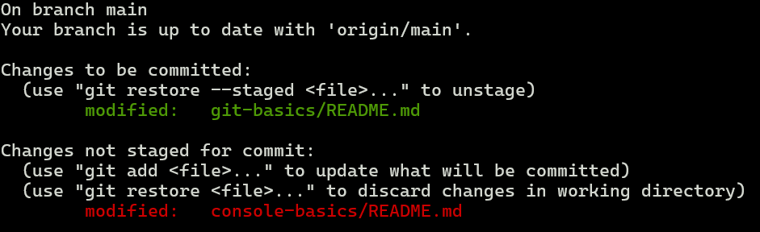

# Все, что нужно знать о git, чтобы начать с ним работать

Git - самая популярная в мире распределённая система контроля версий. 
Она нужна разработчикам в первую очередь для удобной работы с разными версиями кода проекта.
Благодаря ей несколько разработчиков могут легко работать над одним и тем же проектом одновременно не мешая друг другу, 
периодически подтягивая изменения от других людей.

Обычно для одного конкретного проекта создается отдельный репозиторий. 
Репозиторий - хранилище различных версий одного проекта, в котором хранится история всех его изменений.
Git репозитории могут синхронизироваться друг с другом, благодаря этому разработчики могут обмениваться кодом между собой.
Обычно при работе в команде над каким-то проектом разработчики синхронизируют свой локальный репозиторий с глобальным репозиторием, который расположен где-то на сервере. 
В качестве глобального репозитория часто пользуются облачными сервисами вроде (например github, gitlab) или разворачивают на своих серверах свой git сервис (на основе gitlab, gitbucket, итд.).

## Локальная настройка git

### Установка git

#### Windows
Если пользуешься windows, можешь использовать git для windows на основе gitbash, вот инструкция по установке: 
https://git-scm.com/downloads/win.

Однако если ты планируешь заниматься backend или embedded разработкой, или становиться devops инженером, 
то тебе в дальнейшем так или иначе придется иметь дело с unix-подобными системами 
(навык работы с unix-подобными системами для frontend разработчика также ценится, хоть зачастую и не столь обязателен).
Поэтому тут можно убить двух зайцев и начать пользоваться гитом через WSL. 
Документацию по установке и настройке WSL можно посмотреть тут https://learn.microsoft.com/ru-ru/windows/wsl/install. 

#### MacOS
На маках git обычно предустановлен, однако если это не так, вот инструкция по его установке на MacOS:
https://git-scm.com/downloads/mac.

#### Linux
В популярных версиях Linux (например Ubuntu) git обычно предустановлен, 
однако если это не так, вот инструкция по его установке на Linux:
https://git-scm.com/downloads/linux.

### Настройка git

Для того чтобы пользоваться командами git из консоли, необходимо настроить как минимум два параметра:
```shell
git config --global user.name "Your Fullname"
git config --global user.email "your.mail@mail.com"
```

### Привязка локального и глобального git аккаунтов

Чтобы локально иметь доступ ко всем репозиториям, 
к которым ты имеешь его на удаленном git сервисе, 
тебе нужно связать локальный и глобальный гит аккаунты.
Это можно сделать, добавив твой публичный ssh ключ в глобальный аккаунт. 
Про то, как сгенерировать ssh ключ можешь прочитать здесь 
https://github.com/TheYeniseiTrireme/homework-materials/blob/main/ssh-basics/README.md в разделе "Подключение по ключу".
Без доп настроек git будет работать с ключом по умолчанию (если ты при генерации ключа не говоришь, куда его сохранить).

Когда у тебя получилось создать ssh ключ (или если он у тебя уже был), 
полностью скопируй содержимое публичного ключа и добавь его в список разрешенных ключей в своем аккаунте на github/gitlab/итд.
Это уже можно сделать используя веб интерфейс гита 
(доки github: https://docs.github.com/en/authentication/connecting-to-github-with-ssh/adding-a-new-ssh-key-to-your-github-account, 
gitlab: https://docs.gitlab.com/user/ssh/).

Теперь ты можешь работать с глобальными репозиториями со своего компьютера!

## Работа с репозиториями

### Клонирование репозитория (git clone)

Чтобы вытянуть глобальный git репозиторий (создать его локальную копию) его необходимо клонировать по специальной ссылке.

Популярные git сервисы имеют хорошую документацию и в них описано как удобным способом получить ссылку на клонирование репозитория, 
например для github можешь прочитать это тут https://docs.github.com/en/repositories/creating-and-managing-repositories/cloning-a-repository. 

Пример команды для выкачивания репозитория:
```shell
git clone git@github.com:Greewil/version-update-helper.git
```
Для более подробной информации можешь посмотреть документацию этой команды гита:
```shell
git clone --help
```

### Статус локального репозитория (git status)

Чтобы посмотреть информацию о текущем состоянии рабочей директории, 
состоянии текущей ветки и том, 
какие фалы готовы к коммиту можно воспользоваться командой:
```shell
git status
```
которая выдаст примерно следующее:


Здесь отображается много полезной информации: 
- какая текущая ветка репозитория 
("On branch main")

- отличается ли текущая ветка от ветки глобального репозитория 
("Your branch is up to date with 'origin/main'")

- какие файлы будут зафиксированы, если вы исполните команду git commit 
(на скриншоте отображены зеленым, о том, как работает git commit смотри дальше)

- о том, в каких файлах есть изменения, но которые на данный момент не входят в предстоящий коммит 
(красные файлы на скриншоте)

Твоя IDE при работе с проектом будет выдавать всю ту же информацию, просто она будет в разных местах, 
и порой легче получить ее при помощи команды.

### Смена ветки репозитория (git checkout существующая_ветка, git checkout -b новая_ветка)

У репозитория может быть множество веток.
Ветки это по сути параллельные версии кода, 
изменения в которых могут появляться, не влияя на остальные версии кода.
Всегда есть основная ветка, от которой ветвятся все остальные. 
Обычно основная ветка называется **main** (раньше называли **master**).
Обычно принято не вносить изменения напрямую в основную версию, 
чтобы в случае разработчики случайно не вносили много ошибок напрямую в основную версию программы.

Чтобы создать новую ветку можно воспользоваться командой:
```shell
git checkout -b имя_новой_ветки
```
Чтобы перейти в уже существующую локально ветку, можно использовать:
```shell
git checkout имя_существующей_ветки
```
Для более подробной информации можешь посмотреть документацию этой команды гита:
```shell
git checkout --help
```

### Подготовка к фиксации изменений (git add, git rm, git mv, git restore --staged)

Сохранение изменений в новой версии кода в репозитории (фиксация изменений) происходит с помощью коммита.
Чтобы выбрать файлы или папки, которые можно будет зафиксировать, необходимо воспользоваться командой:
```shell
git add путь_1 путь_2 ...
```
Чтобы в следующей фиксации файл или папка были переименованы необходимо выполнить:
```shell
git mv имя_до имя_после
```
Чтобы в следующей фиксации файлы или папки были удалены необходимо выполнить:
```shell
git rm путь_1 путь_2 ...
```
Если расхотелось фиксировать какие-то изменения, которые уже были добавлены:
```shell
git restore --staged путь_1 путь_2 ...
```

### Фиксация изменений (git commit -m "feat: short commit title")

Чтобы зафиксировать выбранные изменения, необходимо выполнить:
```shell
git commit -m "короткое название коммита"
```

Для названия коммитов в последние время все более частой практикой 
стало использование общепринятого соглашения о именовании коммитов 
(подробнее тут: https://www.conventionalcommits.org/ru/v1.0.0/).
Например если ты добавляешь новый функционал в текущем коммите, его нужно именовать с префиксом "feat: ", 
если правите ошибки - с префиксом "fix: " итд.

### Синхронизация текущей ветки с глобальным репозиторием (git push, git pull)

Все изменения фиксируются сначала локально. 
Чтобы отправить их на сервер необходимо запустить команду:
```shell
git push
```
Если же твоей локальной ветки еще нет в глобальном репозитории, 
то **git push** предложит создать ее удаленную копию:
```shell
git push --set-upstream origin имя_ветки
```
Чтобы вытянуть новые коммиты из глобального репозитория к себе локально необходимо выполнить команду:
```shell
git pull
```

### Слияние веток (git merge existing_branch_name)

Порой нужно объединить изменения с двух разных веток 
(например, зачастую люди пишут код в своих ветках и объединяют его в одной общей, зачастую "main" или "master").
Для того чтобы подтянуть изменения из другой ветки в текущую, необходимо использовать следующую команду:
```shell
git merge имя_ветки_изменения_из_которой_мы_вытянем
```
После этого коммиты из выбранной ветки добавятся в текущую, и текущая ветка будет содержать коммиты из обеих веток.

### Конфигурационные файлы репозитория (.gitignore)

Чтобы какие-то файлы и папки не учитывались в git репозитории, можно указать их в файле .gitignore.
Настройки .gitignore файла применяются к той папке, в которой он лежит и ко всем внутренним папкам.
Таких файлов .gitignore может быть несколько и они могут лежать в разных папках репозитория. 

Зачастую это один файл, лежащий в корне проекта, в котором указаны конфиги популярных IDE, папки со сборками проекта итд.

Пример файла .gitignore:
```gitignore
# Cursor (Настройки IDE Cursor не будут сохраняться в гите)
.cursorignore
.cursorindexingignore
# Visual Studio Code (Настройки IDE Visual Studio Code не будут сохраняться в гите)
.vscode/
# Intellij Idea (Настройки IDE Intellij Idea не будут сохраняться в гите)
.idea
```

Также есть другие настроечные файлы git репозиториев (.gitattributes итд.), 
но они не настолько часто встречаются, о них можешь прочитать самостоятельно.

### Дальнейшие наставления

Здесь дан необходимый минимум, 
чтобы можно было выкачивать публичные примеры кода к себе 
и чтобы начать создавать свои проекты самому или вместе с другими людьми.

По ходу работы с git у тебя будут возникать вопросы о работе каких-то команд.
Чтобы найти на них ответы, ты можешь в первую очередь использовать **--help** параметр команды гита, 
во вторую очередь искать ответы в интернете / в нейронках.
