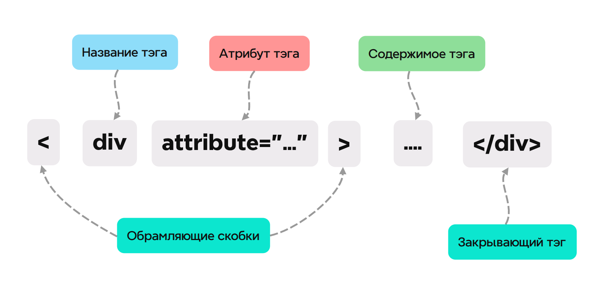
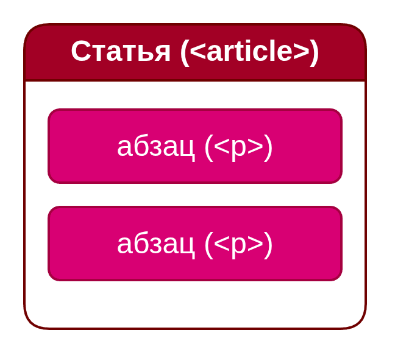
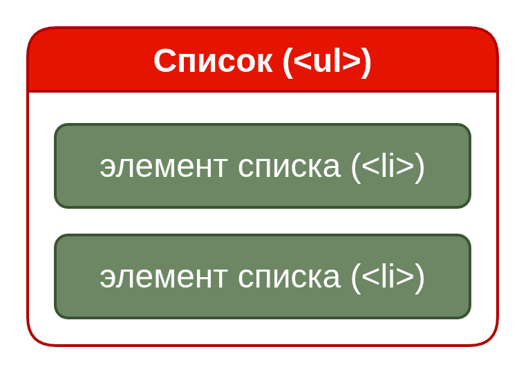
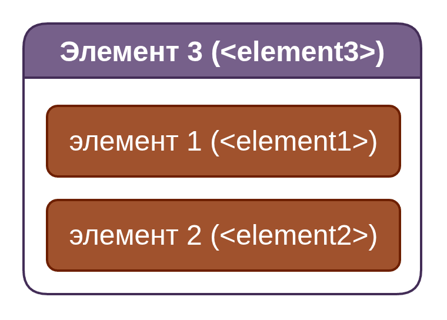

# **1-01** Основы HTML - часть 1
**Привет!**<br>
В прошлом уроке мы краем глаза глянули на то, из чего состоят сайты, веб-приложения, как их части взаимодействуют между собой, и для чего они вообще нужны. Сегодня же мы с тобой начнем углубляться в устройство работы первого кита - **HTML**, языка, отвечающего за разметку сайта. Что ж, начнем!
## План урока
* Создание HTML-документа
* Пример написанного HTML-документа
* Как работают элементы (тэги) в HTML?
* Продолжаем рабирать HTML-документ по кусочкам
* Как вложить один элемент в другой? 
## Создание HTML-документа
1. Для создания нашей первой веб-страницы (он же и первый HTML-документ) нам необходимо создать в удобном месте папочку с названием нашего будущего сайта (например `C:\...\Документы\LabubuSite`) и в этой папочке создаем файл `index.html` (**обязательно именно** `index.html`**!** Почему? Смотри ниже)
2. Далее даббл-кликаем по этому файлу и мы увидим, как он открывается
в браузере: пустая белая страница без ничего. Да, так и должно быть, ведь мы
ничего не написали внутри, но собственный сайт запустили, прогресс! Давай разбираться, что к чему:<br>
HTML-документ в обязательном порядке требует
начальную структуру для файла,
которую мы сделаем с помощью функции
автодополнения, ей будем пользоваться очень
часто в работе (подробнее об этом здесь (TODO: рассказать про расширения вс кода, которые облегчат фронтенд-разработку)). Пишем `!`, высвечивается окно.
Нажимаем `TAB`, выводится следующее:
```
<!DOCTYPE html>
<html lang="en">
<head>
    <meta charset="UTF-8">
    <meta name="viewport" content="width=device-width, initial-scale=1.0">
    <title>Document</title>
</head>
<body>
    
</body>
</html>
```
Ничего не понятно...
#
### Что это вообще за слова и закорючки по бокам?
Таким образом пишутся в HTML ***тэги***:
>Тэги - основная единица HTML-документа, с помощью них описываются все элементы, которые будут находиться на сайте, будь то текст, заголовок, кнопка, поле ввода и т.д.

Из чего состоит тэг:


* Название тэга - в нем мы говорим, какой элемент хотим поместить на сайт (коробка, бутылка, шляпа и т.д.)
* Атрибут тэга - тут ты говорим, какое свойство будет иметь элемент и значение этого свойства в формате `название свойства="значение свойства"` (напр. `форма бутылки` (название свойства) = `"квадратная"` или `"круглая"` (значение свойства) и т.д.)
* Обрамляющие скобки - такими треугольными скобками обрамляют название любого тэга, иначе браузер воспринимать его как обычный текст, а этого нам не надо, правда?
* Содержимое тэга - собственно то, что содержит элемент (напр. текст в текстовом тэге, надпись кнопки в кнопочном тэге и т.д)
* Закрывающий тэг - нужен для того, чтобы показать себе и браузеру, что в этом месте элемент и его содержимое кончаются, и дальше идут следующий элемент/конец страницы, оформляется также, как и открывающий тэг (который идет перед содержимым в схеме), но со слэшем перед названием тэга
#
Фух, вроде с этим разобрались, теперь можно идти дальше!

### Разберем каждый тег по отдельности:

### `<!DOCTYPE html>`
 — с этого тэга начинаются все HTML-документы, отвечает за указание браузеру того, что ты ему скармливаешь не какой-то левый документ, а HTML-верстку со всеми ее элементами, которые браузер должен отобразить. 
* Небольшой пережиток прошлого, когда новые версии HTML выходили часто, и браузеру нужно было понимать, с какой версией HTML он работает; сейчас все сократили до краткого описания того, что документ просто является HTML-версткой

#
### `<html lang="en">`
 — это открывающий тег
корневого элемента HTML-документа с важным атрибутом
lang. Все остальные элементы (заголовок, тело, скрипты,
стили) должны находиться внутри него.

#
### `<head>`
несет в себе **служебную информацию** для страницы, это как бы мозг, личность, голова страницы. В нем указывается:
- `<meta charset="UTF-8">` Определяет кодировку
документа (обязательно для корректного отображения
русских и других символов)
- `<meta name="viewport" content="width=device-width,
initial-scale=1.0">` - Критически важно для адаптивного
дизайна, контролирует масштабирование на мобильных
устройствах.
- `<title>Document</title>` - определяет заголовок
страницы. Отображается во вкладках и используется
как заголовок в результатах поиска.

Кстати, ты заметил, что в шаблоне вышеописанные тэги написаны в содержимом тэга `<head>`, что они как будто *вложены* в этот тэг? Об этом поговорим чуть ниже
#
### `<body>` - контейнер для всего видимого содержимого
веб-страницы, тело нашего сайта. Всё, что находится внутри `<body>`,
отображается в окне браузера и видят пользователи, как тело человека, которое мы видим.
#
C нашим первоначальным шаблоном вроде бы разобрались, и под конец урока затронем одно важное явление, которопе мы наблиюдали ранее:
### Вложенность тэгов
Да-да, вы не ослышались, **тэги можно вкладывать в другие тэги**, вот это да! Для чего это вообще нужно? Ну, например для:
* того, чтобы показать, что элемент содержит в себе другие элементы (напр. несколько абзацев в одной статье):
  

* тэгов списков, которые для своей работы требуют вложенных в них специальных тэгов (элементов списка):
  

* того, чтобы сгруппировать несколько элементов одного назначения ( напр. иконка и подпись кнопки для входа в аккаунт) для дальнейшей их общей стилизации - в таком случае говорят, что `элемент1` и `элемент2` поместили в обертку/обернули в `элемент3`:

#
Так, мы смогли предолеть этот первый порог, мы молодцы! В следующем уроке мы будем рассматривать тэги, зачастую используемые при наполнении страницы содержимым (контентом), их назначения и сценарии использования.