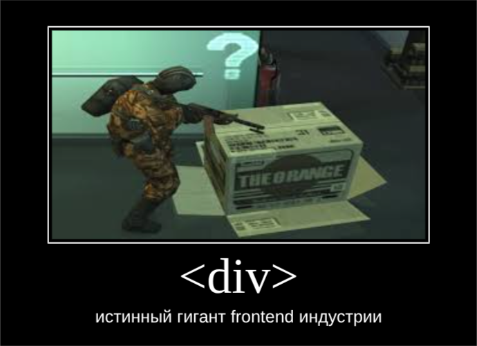
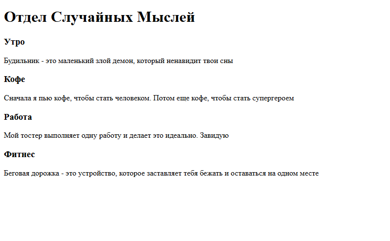
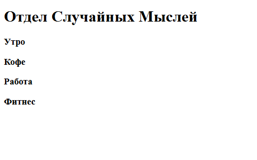
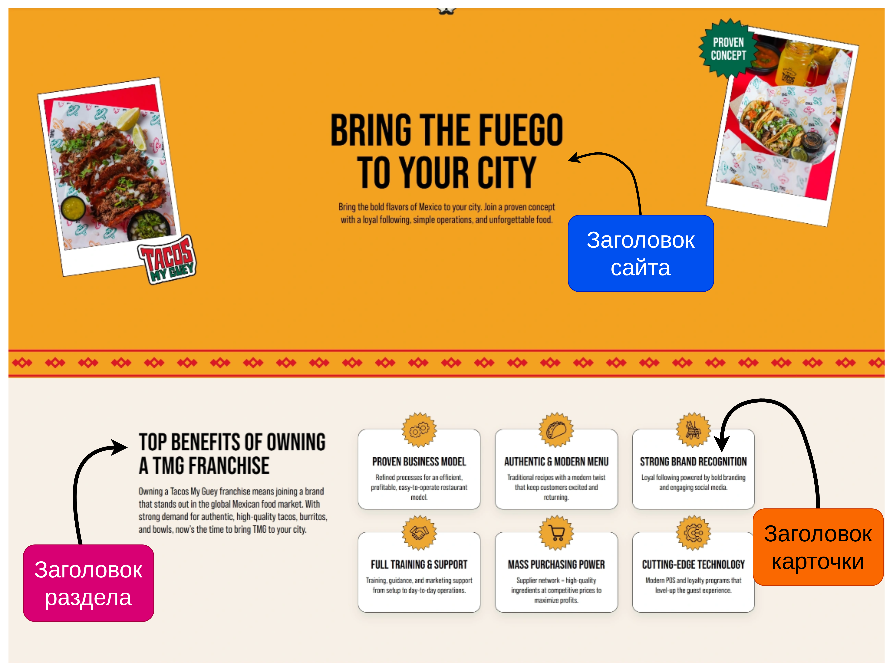

# **1-02** Основы HTML - часть 2
День добрый, молодой человек! В прошлом уроке мы начали углубляться в основы HTML, рассматривали концепцию элементов и тэгов, концепцию их вложенности, увидели, как выглядит базовая HTML-страничка, из каких элементов состоит, каково их назначение. Сегодня же мы рассмотрим часто используемые элементы (в дальнейшем буду их называть тэгами), которые используются для построения видимой части страницы (напомню, это все тэги, что лежат внутри тэга <body>) - заголовки, части страницы, ссылки и т.д., а еще вместе с этим чуть-чуть затронем семантику и ее значимость для верстки. Так, введение немного затянулось... Погнали!
## План урока
  - [ЭТО БАЗА БРАТ](#это-база-брат)
  - [Хедеры и футеры](#хедеры-и-футеры)
  - [Main и section](#main-и-section)
  - [Заголовки](#заголовки)
  - [Ссылки](#ссылки)
  - [Изображения](#изображения)
  - [Значимость...](#значимость)
  
## ЭТО БАЗА БРАТ
Да, **база**, потому что тэг, о котором сейчас мы будем говорить, можно использовать для верстки ~~всей~~ почти всей страницы (но лучше так не делать, об этом [позже](#значимость)), ведь ведь этот тэг олицетворяет самую обычную безликую картонную коробку, в которую можно положить все, даже другую безликую картонную коробку! Встречайте его величество - ``<div>``:


Ладно, похихикали (надеюсь), теперь чуть серьезнее. ``<div>`` - самая базовая единица верстки, которая олицетворяет самый обычный элемент без какого либо явного ***назначения***, используемый зачастую для групировки/обертки других элементов, либо для создания каких либо мелких элементов, где ***назначение*** можно понять по содержимому этих элементов. Этот тэг мы изучили, перейдем же к более специализированным тэгам!<br>
[Подробная документация](https://doka.guide/html/div/)
## Хедеры и футеры
Для того, чтобы понять ***назначение*** уже этих элементов, рассмотрим базовое устройство какой нибудь странички, например Гугла:

Страничку можно разделить на три условные части:
* Голова страницы, где находятся ссылка на домашнюю страницу, поле поиска, кнопки других сервисов гугла и аккаунта того же гугла
* Основное содержимое, где находится то, ради чего мы приходим в Гугл - ссылки по той теме, которая нам интересна, то есть ***назначение*** данного раздела - отображение основного контента сайта, за которым заходит пользователь
* Нижняя часть, условные ноги сайта, где находится по большей части служебная и юридическая информация и/или ссылки на другие страницы и соцсети:

Собственно, для этих частей страницы существуют свои тэги:
* Голова страницы - ``<header>``
* Основной контент - ``<main>``
* Нижняя часть или "подвал" - ``<footer>``

И при создании верстки именно эти тэги используются в первую очередь, т.к. они подразумевают под собой конкретное ***назначение*** для каждой из частей сайта, почему это так важно, будет расписано ниже<br><br>
[Подробная документация](https://doka.guide/html/header/)

## Main и section
Давай чуть-чуть остановимся на главном контенте страницы. Глянем какую-нибудь другую страничку:

Видишь? После хедера идет главный контент страницы, но он тоже как бы разделен на разные части для более комфортного освоения информации, как будто это секции; все правильно, группировать главную информацию на странице можно с помощью тэга ``<section>``! Главное не забудь вложить его в тэг ``<main>``, чтобы было явно видно, что это будет именно раздел главной информации, а не чего-то еще.

TODO [Подробная документация](https://doka.guide/html/main/)

## Заголовки
Заголовки, заголовки... Мы же понимаем, для чего они предназначены? Для озаглавливания тех или иных разделов сайта или блоков с информацией/функционалом. С этим разобрались. Заголовки в HTML оформляются с помощью тэгов ``<h1>`` - ``<h6>``:
```html
<div>
    <h1>Супер заголовок</h1>
    <p>
        Какой-то супер-пупер-мега-дупер-гипер-кибер-текст с каким то глупым описанием размера текста
    </p>
</div>
```
Пойдем дальше. Что за цифры возле буквы h? Цифры обозначают две вещи - размер и ***значимость*** заголовка в контексте сайта, и это обозначение работает по принципу "больше цифра - меньше размер и значимость":<br><br>


Про размер узнали, теперь поговорим про значимость. Посмотрим на вышеупомянутый сайт:

Тут у нас 3 заголовка:
* Заголовок сайта - самый главный и значимый заголовок, без него не будет понятно, зачем вообще этот сайт создали, его нужно оформлять тэгом ``<h1>``
* Заголовок раздела - заголовок поменьше и по размеру и по значимости, но все равно остается ***важным относительно контекста сайта***, ведь он озаглавливает целый раздел сайта, поэтому его нужно оформлять тэгом ``<h2>``
* Заголовок карточки - уже не такой важный заголовок, как прошлые, он озаглавливает всего лишь одну из карточек, которых и несколько, и они размером меньше, значит, нужно оформлять этот заголовок тэгом ``<h3>``<br>

[Подробная документация](https://doka.guide/html/h1-h6/)

## Ссылки
Так, тут будет немного разговоров, потому что ссылка, она и есть ссылка - ведет на какой-либо другой сайт/страницу, оформляется с помощью тэга ``<a>``. Важно знать одно, у этого тэга есть аттрибут ``href`` - собственно путь, куда должна вести твоя ссылка, на какой-либо сайт/страницу:
```html
<a href="google.com">Текст ссылки</a>
```
[Подробная документация](https://doka.guide/html/a/)

## Изображения
Практически такая же ситуация, что и с ссылками, но путь к самой картинке прописывается не через ``href``, а через атрибут ``src``, а также желательно прописывать атрибут ``alt`` - текст, который будет отображаться в случае того, если картинка не загрузится:
```html

```
Результат:

Идем дальше.<br><br>
[Подробная документация](https://doka.guide/html/img/)
## Значимость...
Можно обратить внимание на наш урок и заметить, что я часто выделял слово ***назначение*** при описании различных тэгов. Зачем? Потому что это та вещь, которую нужно держать в уме, когда пишешь верстку. Да, можно сверстать весь сайт на ``<div>``-ах, и это даже будет работать, но так делать не рекомендуется, потому что:
* Браузер и поисковики не будут понимать, где какая часть сайта находится, и за что она отвечает, и следовательно, браузер не сможет корректно реализовать опции доступности (чтение текста вслух, перемещение по сайту без управления мышью и т.д.), а поисковики будут меньше уделять внимания твоему сайту и опускать его в выдаче либо вообще не показывать его в поиске
* В будущем тебе и другим людям, которые возможно будут работать над твой версткой, будет легче понимать, где какая часть сайта находится и, следовательно, по нему будет легче перемещаться и изменять
Такая верстка называется **семантической**, то есть верстка, описывающая не только наличие самих элементов, но и их **значение** для сайта.<br>

Если будет интересно, можешь почитать про семантику [подробнее](https://doka.guide/html/semantics/)
#
Так, на сегодня все! Самые основные тэги изучены, можно начинать писать свою первую страницу! В следующий раз мы рассмотрим DOM (Document Object Model) и поток документа.<br>
>Примечание: подробнее изучить HTML-теги можно по
[ссылке](https://doka.guide/html/)