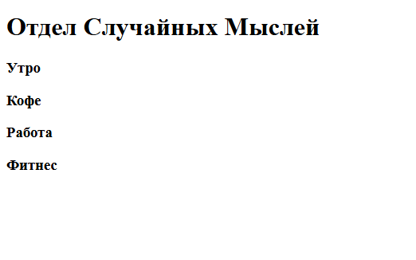
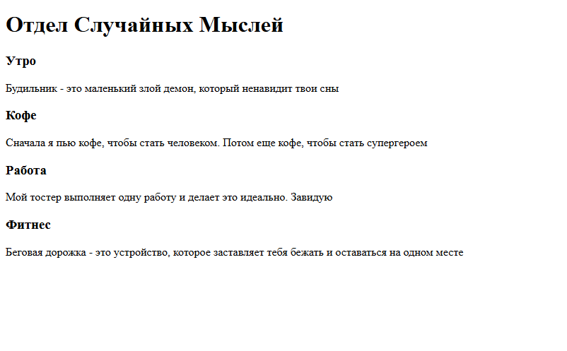

# Как запустить свой первый сайт? 
- Чтобы запустить сайт, нужен сервер.
Сервер - это машина, которая обрабатывает
весь код, правильно его форматирует,
высчитывает логику, прописанную в нем и тд.
Сервер бывает облачный, когда проект загружается
на условную машину, которая транслирует это в
интренет. И локальный, где все изменения только
на твоем компьютере, идеально подходит для разработки.
- В нашем случае, достаточно будет локального
сервера, который запустится в один клик :)
## Начало работы с HTML
- Для начала работы с Html файлом на
примере программы VSCode нам необходимо
создать папку(В дальнейшем будем наполнять
ее другими файлами) и внутри файл
сназванием `index.html`.
Далее даббл-клик по этому файлу, он откроется
в браузере. Откроется пустая страница, ведь мы
ничего не написали внутри. Сайт запустили!
Правда он пуст... Давай разбираться.
- Html в обязательном порядке требует
начальную структуру для файла,
которую мы сделаем с помощью функции
автодополнения, ей будем пользоваться очень
часто в работе. Пишем `!`, высвечивается окно.
Нажимаем `TAB`, выводится следующее:
```
<!DOCTYPE html>
<html lang="en">
<head>
    <meta charset="UTF-8">
    <meta name="viewport" content="width=device-width, initial-scale=1.0">
    <title>Document</title>
</head>
<body>
    
</body>
</html>
```
Ничего не понятно...
### Разберем каждый тег по отдельности:
#
* Тег `<!DOCTYPE html>` — это один из самых
важных элементов в HTML-документе.
* Oтвечает за указание браузеру типа и версии
документа, чтобы тот мог правильно отображать
страницу. За корректное и предсказуемое отображение
твоей веб-страницы в современных браузерах, заставляя
их работать в стандартном режиме.

#
* Тег `<html lang="en">` — это открывающий тег
корневого элемента HTML-документа с важным атрибутом
lang. Все остальные элементы (заголовок, тело, скрипты,
стили) должны находиться внутри него.
* В конце документа обязателен закрывающий тег `</html>`.
*Кстати, 90 процентов html елементов должны в конце
замыкать себя аналогичным тегом*
#
* `<head>` несет в себе служебную информацию для
страницы. В нем указывается:
    * `<meta charset="UTF-8">` Определяет кодировку
    документа (обязательно для корректного отображения
    русских и других символов)
    *  `<meta name="viewport" content="width=device-width,
    initial-scale=1.0">` - Критически важно для адаптивного
    дизайна, контролирует масштабирование на мобильных
    устройствах.
    * `<title>Document</title>` - определяет заголовок
    страницы. Отображается во вкладках и используется
    как заголовок в результатах поиска.
#
* `<body>` - контейнер для всего видимого содержимого
веб-страницы. Всё, что находится внутри `<body>`,
отображается в окне браузера и видят пользователи. Дальше
разберем, что может находиться внутри этого тега:
# Основные инструменты для работы с html:
### Разметка
* `<h1>` - тег для текста, который обычно используется
в заголовках. Существуют градации от `<h1>` - `<h5>`.
Цифры в нем означают размер. Где 1 - самый большой, а
5 - самый маленький. Повторим данную конструкцию:
```
<body>
    <h1>Отдел Случайных Мыслей</h1>
        <h3>Утро</h3>
        
        <h3>Кофе</h3>
        
        <h3>Работа</h3>
        
        <h3>Фитнес</h3>
</body>
```
*  Здесь мы вывели главный
заголовок и 4 подзаголовка,
*Чтобы увидеть изменения на странице, мы должны
сохранить файл, в котором провели работу(обязательно)
и обновить страницу.*

- Выглядит это так:


#
* Добавим текст под заголовками с помощью `<p>`:
```    <h1>Отдел Случайных Мыслей</h1>
        
        <h3>Утро</h3>
            <p>
            Будильник - это маленький злой демон,
            который ненавидит твои сны
            </p>
        
        <h3>Кофе</h3>
            <p>
            Сначала я пью кофе, чтобы стать человеком.
            Потом еще кофе, чтобы стать супергероем
            </p>
        
        <h3>Работа</h3>
            <p>
            Мой тостер выполняет одну работу и делает 
            это идеально. Завидую
            </p>
        
        <h3>Фитнес</h3>
            <p>
            Беговая дорожка - это устройство, которое
            заставляет тебя бежать и оставаться на одном месте
            <p>
```
* И получаем:



- У нас получился самый обыкновенный текст.

* Также, в html есть тег `<div>`, который "группирует"
элементы, которые в нем находятся. Т.е. помещают
элементы в "коробку" по структуре: 
```
<div>
    * внутри "коробки"*
<div/>
```
* Давай поместим каждую секцию с мини-темами в `<div>`:
```
<body>
    <h1>Отдел Случайных Мыслей</h1>
        
        <div>
            <h3>Утро</h3>
                <p>
                Будильник - это маленький злой демон,
                который ненавидит твои сны
                </p>
        <div/>
        <div>
            <h3>Кофе</h3>
                <p>
                Сначала я пью кофе, чтобы стать человеком.
                Потом еще кофе, чтобы стать супергероем
                </p>
        <div/>

        <div>
            <h3>Работа</h3>
                <p>
                Мой тостер выполняет одну работу и делает 
                это идеально. Завидую
                </p>
        <div/>

        <div>
            <h3>Фитнес</h3>
                <p>
                Беговая дорожка - это устройство, которое
                заставляет тебя бежать и оставаться на одном месте
                <p>
        <div/>
</body>
```
Зачем мы это сделали? Визуально ничего не изменилось,
но для верстки эдакие "дивы" очень важный элемент.
Чтобы нагляднее понять, расскажу про важную вещь
для понимания структуры html документа.
## DOM-дерево (Document Object Model) 
-  это представление HTML-документа в виде древовидной
структуры объектов, которую понимают и с которой могут
взаимодействовать языки программирования, такие как `Css`
или `JavaScript`.

### Представь это так:
 

Выглядит запутанно, но если обратить внимание на отдельные элементы, 
можно понять, что если бы не наши "дивы", то после `<body>` у нас 
бы получился огромный веер из маленьких веток.
- Представь, что ты берешь одну из веток у настоящего дерева и, например,
наклоняешь ее. Вместе с веткой перемещается все ее содержимое.
Так и в html, на дивы мы разделяем элементы, чтобы можно было 
взаимодествовать с внутренними элементами сразу, например, группированно 
переместить, или покрасить для них фон. Что нас и ждет в следующем уроке


# В следующем уроке рассмотрим, как видоизменять компоненты с помощью `style` и `CSS`.
 Подробно изучить html теги можно по
[ссылке](https://gist.github.com/dmitry-osin/4d50ec8316fb33552e9283f78a7162bb)