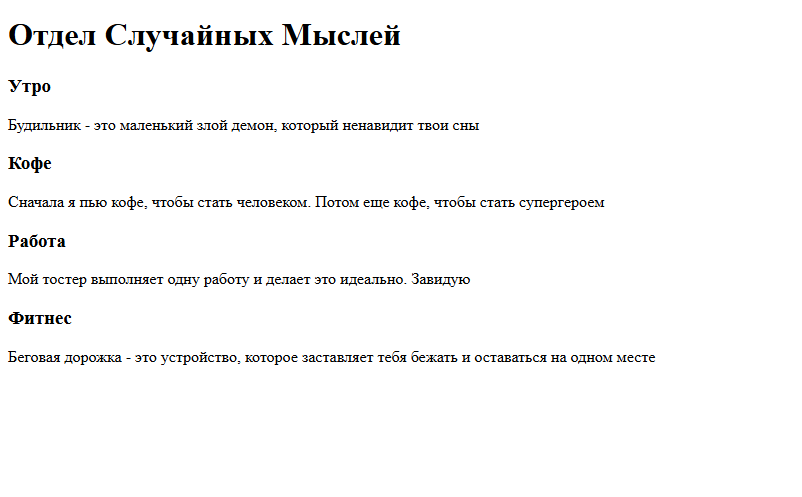
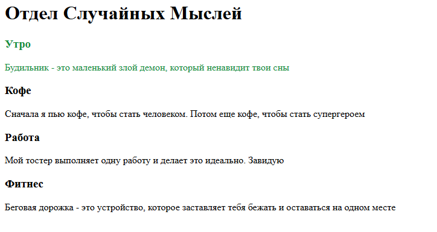
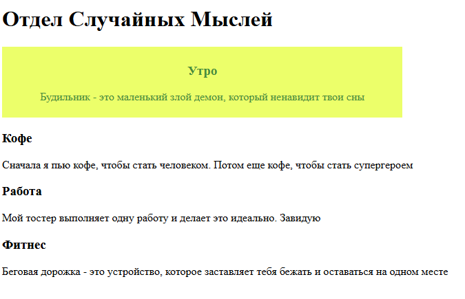

# CSS и основы для создания красочного интерфейса
* Сегодня мы научимся видоизменять элементы, например, которые возвели 
в предыдущем уроке.
Мы имеем такую структуру видимых елементов:

```html
<body>
    <h1>Отдел Случайных Мыслей</h1>
        
    <div>
        <h3>Утро</h3>
            <p>Будильник - это маленький злой демон,
            который ненавидит твои сны</p>
    <div/>

    <div>
        <h3>Кофе</h3>
            <p>Сначала я пью кофе, чтобы стать человеком.
            Потом еще кофе, чтобы стать супергероем</p>
    <div/>

    <div>
        <h3>Работа</h3>
            <p>Мой тостер выполняет одну работу и делает 
            это идеально. Завидую</p>
    <div/>

    <div>
        <h3>Фитнес</h3>
            <p>Беговая дорожка - это устройство, которое
            заставляет тебя бежать и оставаться на одном месте<p>
    <div/>
<body/>
```

И так это выглядит на сайте:



### Сегодня мы разберем 2 способа для кастомизации тега. Первый:
# `style="..."`
### Возьмем в пример секцию "Утро" и сделаем, допустим, синий цвет для всего текста.
Для этого нам нужно внутрь открывающего тега `<div>` в котором находится контент вписать 
`style=""`.
```html
<div style="">
    <h3>Утро</h3>
        <p>Будильник - это маленький злой демон, который ненавидит твои сны</p>
    </div>
```
- Внутри кавычек мы будем описывать стили. Их слишком много, чтобы учить все, для 
  начальной работы будет достаточно штук 20. Сегодня разберем лишь несколько. 
- Начинаем вводить color, нажимаем `tab` программа позволяет выбрать из существующих, 
  нажимаем на любой цвет, и при нажатии на квадрат с цветом, открывается палитра, где можем выбрать нужный. у меня получился такой: (25, 143, 60).
```html
<div style="color: rgb(25, 143, 60);">
    <h3>Утро</h3>
    <p>Будильник - это маленький злой демон, который ненавидит твои сны</p>
</div>
```
### Сохраняем, обновляем, видим следующее:


### Цвет текста изменился.
- Лобавим еще несколько стилей:

```html
<div style="color: rgb(25, 143, 60);
    background-color: rgb(233, 255, 106);
    max-width: 40%;
    text-align: center;
    padding: 10px;
    margin: 10px>
```


- ##  Что здесь произошло? 
### **`background-color: rgb(233, 255, 106);`** 
 Изменение цвета для фона объекта
### **`max-width: 40%;`**
Установка максимальной ширины объекта <br> 
   *(в процентах пишется тогда, когда нужно, чтобы элемент брал 100% от размера элемента, в котором находится и занимал ровно 40%)*
### **`text-align: center;`**
Выравнивает текст по центру внутри элемента
### **`padding: 10px;`**
Расстояние между внутренними краями объекта и контентом внутри
### **`margin: 10px`**
Расстояние между внешними краями и другим элементом снаружи

#
  
- Рекомендую вписывать по одному стилю и каждый раз смотреть, что после этого происходит.

- Описание стиля лишь для одного элемента в итоге заняло столько строк...  А если мы будем каждый элемент так описывать, в коде будет ориентироваться очень сложно!
Исправим)

# Классы 
- Представь себе **нефора**. Сразу в голове картинка: длинные крашеные волосы, мешковатая одежда. Ты смог это представить, потому что у тебя выстроилась ассоциация со словом: "нефор".  Так и с CSS, только ты прописываешь ассоциации, и потом просто говоришь html, чтобы он подставил нужный класс.
Например, для остальных наших секциий, которые так и остались черно белые. сделаем их такими же, как и "утро"
Чтобы не вводить под каждый, мы выпишем класс в отдельное место и каждому элементу будем присваивать его значение. Одной строчкой.
#
- Нам нужно создать специальное пространсто для наших классов

```html
<html lang="en">
<head>
    ...
</head>
<body>
    ...   
</body>
<style>
    *вот здесь*
</style>
</html>
```

- Далее, в этом теге пишем название для класса по такой структуре:
```css

<style>
.AnyName{
   ***
}
</style>

```
Название для класса можешь придумать какое угодно.
  #
- Полностью перенесем все стили из нашего тега "Утро" на место звездочек:

```css
<style>
.AnyName{
    color: rgb(25, 143, 60);
    background-color: rgb(233, 255, 106);
    max-width: 30%;
    padding: 5px;
    text-align: center;
    margin: 10px
}
</style>
```
#
Теперь для того самого дива присваеваем class:
```html 
<div class="AnyName"> 
    <h3>Утро</h3>
    <p>Будильник - это маленький злой демон, который ненавидит твои сны</p>
</div>
```

### Обновляем, смотрим, все работает!
Теперь мы можем так-же сделать с остальными `<div>`: 
```html
<body>
    <h1>Отдел Случайных Мыслей</h1>
        <div class="AnyName"> 
            <h3>Утро</h3>
            <p>Будильник - это маленький злой демон, 
            который ненавидит твои сны</p>
        </div>

        <div class="AnyName">
            <h3>Кофе</h3>
            <p>Сначала я пью кофе, чтобы стать человеком.
            Потом еще кофе, чтобы стать супергероем</p>
        </div>

        <div class="AnyName"> 
            <h3>Работа</h3>
            <p>Мой тостер выполняет одну работу и делает 
            это идеально. Завидую</p>
        </div>    

        <div class="AnyName"> 
            <h3>Фитнес</h3>
            <p>Беговая дорожка - это устройство, которое
            заставляет тебя бежать и оставаться на одном месте<p>
        </div>
</body>
```
### **Работает!**
Еще, мы можем настраивать стили для уже существующих тегов. Например, покажу, как поменять шрифт для **всего** нашего текста:
```css
h1, h3, p {
    font-family: 'Franklin Gothic Medium', 'Arial Narrow', Arial, sans-serif;
}
```


Удобно, да?
Кстати, когда ты вводишь `font-family` программа выдает тебе кучу шрифтов, так что есть из чего выбрать.  
#
- Таким образом, мы можем создавать много классов и присваивать их нужным элементам.
- Преимущество этого способа в том, что очень много места освобождается в месте, где ты в моменте работаешь. Так-же позволяет структурировать все рабочее пространство и разделить классы и разметку по своим местам. Круто. Можем сделать еще круче.

# Изменение парараметров стилей во время событий
Мы можем присвоить стиль к определенному событию. Например, сделаем обработку событий **при наведении курсором**. Для этого в `<styles>` пропишем следующее:
```css
.AnyName:hover{
    color: rgb(143, 92, 25);
    background-color: rgb(255, 220, 106);
    scale: 1.05;
}
```
### **`color: rgb(143, 92, 25);`**
Изменили цвет
### **`background-color: rgb(255, 220, 106);`**
Изменили фон карточки
### **`scale: 1.05;`**
Увеличили размер объекта на 5%

<video controls src="20251014-2037-45.2655741.mp4" title="Title"></video>
#
## Добавим плавную анимацию
Для этого мы пропишем в нашем основном стиле:

```css
.AnyName{
    color: rgb(25, 143, 60);
    background-color: rgb(233, 255, 106);
    max-width: 30%;
    padding: 5px;
    text-align: center;
    margin: 10px;
    transition: 0.3s;  *переход будет занимать 0,3 секунды*
}
```


<video controls src="20251014-2048-39.8927414.mp4" title="Title"></video>


<!-- - style +
- class по имени тега 
- class через точку с указанием
- описать, что классов может быть несколько, и что это можно увидеть в бравзере
- базовые параметры css, единицы измерения (относительные и абсолютные), margin, padding
- переопределение параметров классов во время событий (ховеры, клики например)
- транзишены (плавные изменения на ховерах например) -->